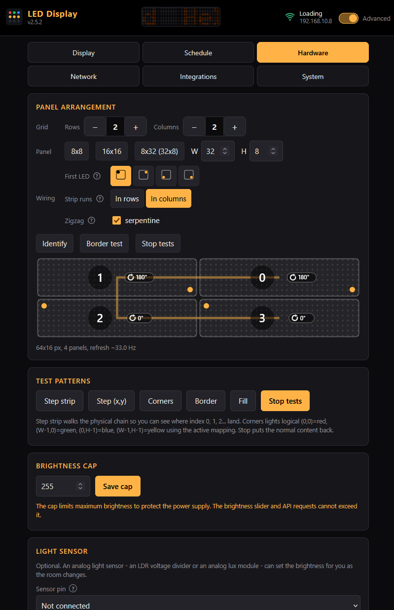

<p align="center">
  
</p>

<h1 align="center">led-display</h1>

<p align="center">
  <a href="https://giovi321.github.io/led-display/"></a>
  <a href="LICENSE"></a>
  
  
</p>

<p align="center">
  <a href="https://giovi321.github.io/led-display/">
    
  </a>
</p>

<p align="center">
  <!-- ?v= busts GitHub's image proxy cache; bump it whenever the drawing changes. -->
  
</p>

ESP-IDF firmware for the ESP32-S3 that drives chained WS2812B panels as one display, for showing a single number that matters: a revenue figure, a subscriber count, a temperature, a countdown.

Chain the panels in whatever order the connectors allow and mount them whichever way up they fit. Instead of rewiring or recompiling, press Identify: every physical panel lights its own colour, you drag the on-screen panels until the drawing matches the wall, and apply.

## What it does

Everything is configured from one hand-written page served gzipped from flash, in a simple mode (text, colour, brightness, schedule) or an advanced mode that adds the hardware, network, integrations and system tabs. Anything you can click, you can also script: the UI and the HTTP API cover the same ground. One device name becomes the hostname, the setup network's SSID and the `device` field in webhooks.

### The wiring stops mattering once you draw the wall

- Describe one panel (size, first-LED corner, row or column walk, serpentine) and lay the panels on a grid of up to 8 x 16 cells, capped at 32 panels and 8192 pixels
- Drag a panel to swap it, click to rotate it, and press Identify to light every physical panel in its own colour until the drawing matches the wall
- Apply rebuilds the pixel mapping live and stores it, so a panel glued in rotated or chained out of order costs nothing to correct

### The readout is built for a number that changes

- Three pixel fonts at integer sizes: 5x7, a tiny 3x5, and a tall 7x12 with real lowercase
- Proportional spacing with fixed-width digits, so a ticking value never wobbles as the digits change; monospace on request
- Scrolling off, restart, or continuous as a marquee that repeats after a two-character gap
- Up to 12 named colour presets, stored on the device so every browser and phone sees the same list

### The sender pushes a raw number and the device owns the rest

- `POST /api/value` with `{"value": 4210.5}`; the device applies the prefix, suffix, decimals and thousands separator, so every feed stays a one-liner
- An optional MQTT client takes the same values over a broker, controls brightness, power and content source, publishes a retained state topic, and announces itself to Home Assistant
- A staleness guard reacts when nothing has arrived for a set number of hours: dim the panel, mark a corner pixel, or swap in a fallback text
- The content source switches between the text you typed and the live value, with a placeholder covering the gap before the first push

### It handles the states you are not there to see

- A per-weekday schedule turns the display off or holds it at a dim level, on an IANA timezone the device applies itself, so clock changes need no re-saving; unticked days either stay dark or ignore the schedule entirely
- An optional BH1750 lux meter on the board's I2C connector sets the brightness from the room, calibrated against a live reading in the browser
- Separate screens cover the boot splash, normal running, and a lost WiFi link, which can hold the content, show a message, go dark, or mark one pixel at a position, colour and brightness you pick
- Up to five saved WiFi networks: the strongest in range wins at boot, a lost link retries with a growing backoff, and the setup AP returns only when nothing answers

### Every operational change is optional or reversible

- OTA updates run both ways, a `.bin` uploaded from the browser or pulled from a URL, and an image that fails to boot rolls back on its own
- The whole configuration exports and restores as one JSON file, with WiFi credentials deliberately excluded so it can move between devices and people
- Two locks, both off by default: an API key for scripts, and a browser login over the whole interface
- An optional WireGuard client reaches the device from outside the LAN without a port forward
- Outbound webhooks POST boot, IP change, OTA result, schedule on and off, and stale value to one URL, fire and forget

## Hardware

The reference build this firmware runs on:

| Item        | Detail                                              |
|-------------|-----------------------------------------------------|
| MCU board   | ESP32-S3-DevKitC-1, ESP32-S3-WROOM-1 N16R8          |
| Flash/PSRAM | 16 MB QIO flash, 8 MB OPI PSRAM                     |
| LED panels  | 4x WS2812B 32x8 (5 V) in a 2x2 grid = 64x16 (1024 LEDs) |
| Wiring      | Per panel: column-serpentine, top-left origin       |
| Chain       | controller -> TL -> TR -> BR -> BL                  |
| Mounting    | Top panels upright, bottom panels rotated 180 deg   |
| Data pin    | GPIO 16 (through SN74HCT125N level shifter to 5 V)  |
| PCB         | 2-layer, about 63.6 x 48.6 mm, all through-hole; sockets the dev board, breaks 5 V out to four panel power connectors and carries an I2C connector for the light sensor. Fritzing v4 source + Gerbers in [`PCB/`](PCB/) |

The PCB expects 5 V LED panels: the supply rail, the level shifter and the connectors are all laid out for 5 V WS2812B-class matrices. 12 V variants need a different power arrangement and are not supported by this board.

None of that grid is fixed in the firmware. It takes any identical-panel grid: panel sizes 1..64 in each dimension, up to 8 rows by 16 columns, capped at 32 panels and 8192 pixels total. Hardware notes (parts, level shifter wiring, connectors) are in the [hardware guide](https://giovi321.github.io/led-display/getting-started/hardware/), the physical build in the [assembly guide](https://giovi321.github.io/led-display/getting-started/assembly/), and the measured power figures in the [power budget](https://giovi321.github.io/led-display/architecture/power/).

## Quick start

1. Flash over USB once:

   ```sh
   cd Firmware
   idf.py set-target esp32s3
   idf.py build
   idf.py -p /dev/ttyACM0 flash monitor
   ```

   Devices running v1 also need this one USB reflash, because 2.0.0 installs a new OTA partition table. Stored settings and WiFi credentials survive it. Every later update goes through the web UI.

2. The device boots, finds no stored credentials and opens an AP named `LEDDisplay-Setup`, or after the device name you set. The panels scroll the SSID and the address; connect from a phone or laptop and the captive portal redirects to `http://192.168.4.1/`.

3. Pick your network, enter the password, save. The device reboots onto your network and shows its IP on the panels (default boot screen on a fresh install). Open that IP in a browser.

## Screenshots

<p align="center">
  
  
</p>

The Display tab and the arrangement editor. The editor draws each panel with its chain index, the corner its first LED sits in, and how it is mounted; Identify lights the physical panels in the same colours so you can drag the drawing until it matches the wall.

## Security

This is a LAN device speaking plain HTTP. Treat it that way.

- There is no TLS on the device. Anything on the same network can read the traffic
- With no API key configured, every endpoint is open. That is the deliberate trusted-LAN default
- With an API key configured, every POST requires `X-Api-Key`. GETs stay open, except the config export, which contains the API key and the WireGuard private key and is therefore key-protected. The key guards against casual misuse, not against a hostile network
- With the web UI login enabled, every URI needs HTTP Basic credentials as well: pages, assets and the whole API, the open GETs included. It is Basic over plain HTTP, so it keeps casual visitors on the network out of the interface and is no defence against anyone watching the traffic. It is not applied on the setup AP, which is what makes a lost password recoverable: the board has no reset button, so the way back is to stop the device reaching WiFi and wait for it to raise its own network
- The WiFi endpoints stay keyless in one case only: the captive-portal setup AP of a device with no saved network, where no key could have been set yet. A provisioned device that fell back to that AP still needs the key, so keep it: without it, WiFi cannot be reconfigured from the portal and the way back is a USB reflash
- Requests that change something must address the device by its own IP, WireGuard address or device name; anything else is refused with 403, which keeps a random page in your browser from posting to the display
- Secrets (WiFi password, API key, WireGuard private key) never appear in status or config GET responses; they only leave the device in the key-protected export
- For remote access, run the built-in WireGuard client to a peer you control. Do not port-forward the device

## Repository layout

```
.
├── DESIGN.md                firmware v2 design document
├── docs/                    documentation site (Astro Starlight, deployed to GitHub Pages)
├── Firmware/                ESP-IDF 6 application, target esp32s3
│   ├── partitions.csv       OTA partition table (two 6 MB app slots)
│   ├── components/
│   │   └── esp_wireguard/   vendored WireGuard component, ported to ESP-IDF 6 (see its PORTING.md)
│   ├── main/
│   │   ├── main.c           boot order
│   │   ├── mapping.[hc]     pure LUT builder for the panel arrangement (host-testable)
│   │   ├── led_driver.[hc]  RMT/led_strip, brightness + cap, LUT application
│   │   ├── display.[hc]     frame buffer, scroll modes, test patterns, identify
│   │   ├── fonts.[hc]       the three pixel fonts + spacing rules (pure, host-testable)
│   │   ├── valuefmt.[hc]    value formatting (pure, host-testable)
│   │   ├── settings.[hc]    NVS persistence, JSON blobs
│   │   ├── scheduler.[hc]   on/off schedule, brightness arbiter, staleness tick
│   │   ├── light_sensor.[hc] ambient sensor sampling; light_curve.[hc] is its pure half
│   │   ├── integrations.[hc] API key, value config, webhook config
│   │   ├── devname.[hc]     device-name rules (pure, host-testable)
│   │   ├── webhooks.[hc]    outbound webhook queue
│   │   ├── wifi_manager.[hc] saved networks, STA + captive-portal AP; wifi_pick.[hc] orders the attempts
│   │   ├── wg_client.[hc]   WireGuard lifecycle
│   │   ├── ota_update.[hc]  OTA slots, rollback
│   │   ├── web_server.c     server setup, static assets, captive-portal probes
│   │   ├── api_*.c          one HTTP handler file per domain
│   │   └── web/             index.html, style.css, app.js, editor.js (gzipped at build)
│   ├── test/host/           host unit tests (plain gcc + assert)
│   └── tools/wsl_build.sh   build helper for a WSL-hosted toolchain
├── PCB/                     Fritzing source + Gerbers (v4 board)
└── 3D/                      enclosure parts: DXF outlines to cut, STL to print
    ├── 8x32/                parts of the reference build, from 32x8 panels
    │   ├── Display modules support panel.dxf
    │   ├── Front and back panels.dxf
    │   └── Spacers.stl
    ├── Box for PCB_v2.stl   printed case for the controller board
    └── USB type c connector flange.stl
```

The SketchUp sources the parts were modelled in are not tracked; the repository ships the STL and DXF exports. The [assembly guide](https://giovi321.github.io/led-display/getting-started/assembly/) walks through building the reference display from them.

## Development

The [documentation site](https://giovi321.github.io/led-display/) covers the API reference, the mapping model and the build setup in detail. The short version: ESP-IDF v6.0.1, `idf.py set-target esp32s3`, and if your toolchain lives in WSL, `Firmware/tools/wsl_build.sh` mirrors the tree and builds outside the network mount. The pure modules (`mapping.c`, `valuefmt.c`, `fonts.c`, `wifi_pick.c`, `devname.c`, `light_curve.c`) have host-side unit tests under `Firmware/test/host/`; they must pass before any PR. See [CONTRIBUTING.md](CONTRIBUTING.md).

## License

[MIT](LICENSE)
