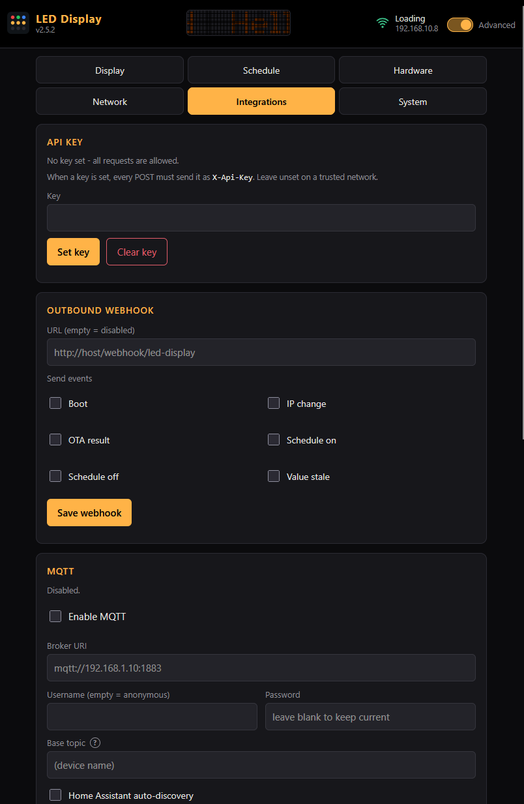

The optional MQTT client makes the display a node on your broker: other systems push values or text to it, control brightness, power and the content source, and read a retained status topic. With Home Assistant discovery enabled, the display appears in HA as a device with ready-made entities - no YAML.

Everything lives on the Integrations tab (advanced mode) or via `GET`/`POST /api/mqtt`. The client stays down until you enable it and set a broker URI.



## Broker connection

| Field | Meaning |
|-------|---------|
| Broker URI | `mqtt://host:1883` for plain TCP, `mqtts://host:8883` for TLS (validated against the firmware's CA bundle), `ws://`/`wss://` for websockets |
| Username / password | empty username connects anonymously. A saved password is kept when the form is re-saved with a blank password field |
| Base topic | the prefix under which every topic below lives. Empty uses the [device name](../../api-reference/system/#post-apisystemdevice_name) |

The client reconnects on its own after broker or WiFi outages. A last-will message marks the device `offline` when the connection drops uncleanly.

The client ID and, when no base topic is set, the topic prefix are taken from the device name at connect time. Renaming the device therefore moves its topics only after the MQTT config is saved again or the device reboots - which is deliberate, so a rename cannot silently orphan a broker ACL or a Home Assistant device mid-session.

Note the security boundary: MQTT commands are **not** gated by the [API key](../api-key/) - the broker's own authentication and ACLs are what stands between the network and the display. Point the device only at a broker you trust, and scope its ACL to the base topic.

## Topics

`BASE` is the base topic. Commands (`.../set`) are subscribed; the rest is published by the device.

| Topic | Direction | Payload |
|-------|-----------|---------|
| `BASE/availability` | out, retained | `online` / `offline` (last will) |
| `BASE/state` | out, retained | JSON state, every 30 s and after each command |
| `BASE/text/set` | in | text to show and persist as the static text (like `POST /api/display/text`) |
| `BASE/value/set` | in | raw value; formatted and treated exactly like `POST /api/value` |
| `BASE/brightness/set` | in | `0`..`255`, clamped to the brightness cap |
| `BASE/power/set` | in | `ON` / `OFF` (also `1`/`0`, `true`/`false`). OFF blanks the panel without touching stored settings; ON restores the configured content |
| `BASE/source/set` | in | `static` / `integration`, switches the [content source](../../user-guide/display/#content-source) |
| `BASE/reboot/set` | in | any payload reboots the device |

The state JSON:

```json
{"power": "ON", "brightness": 32, "text": "CHF 12'345.6", "source": "integration",
 "value_age_s": 42, "rssi": -58, "ip": "192.168.1.50", "fw": "2.3.0", "uptime_s": 86452}
```

`power` reports whether the panel is showing anything; `brightness` is the stored user level (what the slider says, not what the schedule or light sensor currently applies); `value_age_s` is `-1` before the first value.

## Home Assistant discovery

Tick "Home Assistant auto-discovery" and the device publishes retained discovery configs under the discovery prefix (default `homeassistant`) on every connect. HA then shows one device with:

| Entity | Type | Backed by |
|--------|------|-----------|
| Display | light | `power/set` + `brightness/set`, state from `BASE/state` |
| Text | text | `text/set` |
| Content source | select | `source/set` (`static` / `integration`) |
| Reboot | button | `reboot/set` |
| WiFi RSSI | sensor (diagnostic) | `BASE/state` |
| Value age | sensor (diagnostic) | `BASE/state` |

The device page links back to the web UI (configuration URL). Turning discovery off publishes empty retained payloads to the config topics, so the entities disappear from HA instead of going ghost.

To feed the display from a HA automation, publish to `BASE/value/set`:

```yaml
action: mqtt.publish
data:
  topic: led-display/value/set
  payload: "{{ states('sensor.your_number') }}"
```

## Build option

MQTT support is compiled in by default (`CONFIG_LEDDISP_MQTT=y`). Building with it off removes the client from the image entirely; `GET /api/mqtt` then reports `compiled_in: false` and the card in the UI says so.

## Related pages

- [Value updates](../../user-guide/value-updates/): the HTTP twin of `value/set` and the formatting pipeline
- [API key](../api-key/): what the key does and does not protect
- [API reference](../../api-reference/integrations/): `GET`/`POST /api/mqtt` shapes
