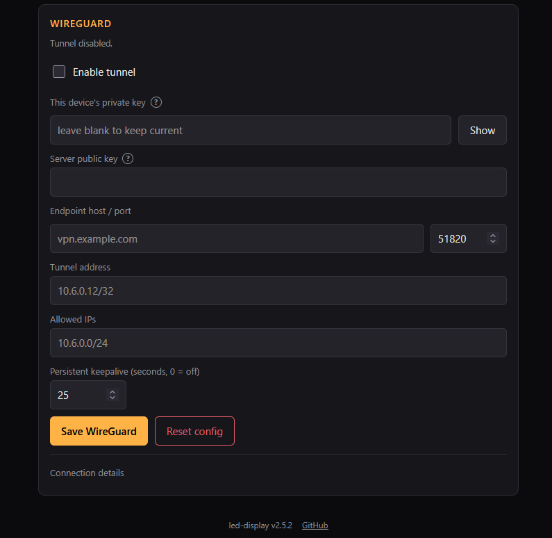

The firmware includes an optional WireGuard client. Its purpose is remote access done right: the device dials out to a WireGuard peer you control (a VPS, a home router, an existing VPN server) and becomes reachable through the encrypted tunnel. The alternative, port-forwarding the device's plain-HTTP port 80 to the internet, would expose an unauthenticated or at best [shared-key](../api-key/) HTTP API to the whole world. Do not do that.

## The vendored component

The WireGuard implementation is a vendored copy of the `esp_wireguard` component, taken from the droscy fork (release 0.4.5) of the original trombik project, chosen because it already carried fixes for ESP-IDF 6 and mbedtls 4. It was then ported for this firmware; the full list of local changes, validation notes, and runtime caveats lives in `Firmware/components/esp_wireguard/PORTING.md` in the repository.

## Configuration

Network tab ([advanced mode](../advanced-mode/)), WireGuard card, or `POST /api/wireguard`. The fields:



| Field | Meaning |
|-------|---------|
| enabled | starts or stops the tunnel; all other fields must be filled before enabling |
| private_key | the device's own WireGuard private key; write-only, leaving it blank on save keeps the stored key |
| peer_public_key | public key of the peer the device connects to |
| endpoint_host, endpoint_port | where the peer listens; hostname or IP, default port 51820 |
| address | the device's IP inside the tunnel, CIDR notation; a bare IP is treated as /32 |
| allowed_ips | comma-separated IPv4 CIDRs routed through the tunnel; 0.0.0.0/0 makes the tunnel the default route |
| keepalive_s | persistent keepalive in seconds, default 25, 0 disables; keep it on when the device sits behind NAT |

Reset config clears all of it, including the private key. That needs its own button because every field here keeps its stored value when left out of a save, and the private key deliberately cannot be cleared by sending an empty string, so there is otherwise no way back to blank. Through the API it is `POST /api/wireguard` with `{"reset": true}`.

The device does not generate keys. Create the pair on any machine with WireGuard tools and paste the private key into the form:

```bash
wg genkey | tee device.key | wg pubkey > device.pub
```

On the peer side, add the device as a `[Peer]` with `AllowedIPs` set to the device's tunnel address as a /32.

Most people never do that by hand. A server that generates the client configuration for you (UniFi, and most router and VPN provider interfaces) creates the keypair at its end, keeps the public half itself, and hands you a config containing the **private** key. Paste that private key into the display and the two sides already agree; there is nothing to copy back. The display's own public key is shown under Connection details for the case where you are writing the server's peer entry yourself, or want to confirm which key the device is presenting, and in `GET /api/wireguard` as `status.public_key`. The public half is not a secret; the private key never leaves the device except through the [config export](../backup-restore/).

## Tunnel address and what it can reach

The tunnel address is normally written as a /32, the way `wg-quick` configurations do it, and the firmware accepts that. But a /32 needs a caveat here, because this device has no routing table: lwIP chooses an interface by matching the destination against each interface's own subnet and otherwise falls back to the default interface. Taken literally, a /32 tunnel matches nothing at all, not even the peer at the other end, so replies to anything inside the tunnel would leave over WiFi and disappear. A tunnel that completes a handshake but cannot be pinged is exactly this.

The firmware therefore gives the tunnel interface the widest Allowed IPs range that contains its own address: with address `10.6.0.2/32` and allowed IPs `10.6.0.0/24`, the interface comes up as `10.6.0.2/24` and the whole tunnel subnet is reachable in both directions. Allowed IPs is already the list of what belongs to the tunnel, so this needs no extra setting. `0.0.0.0/0` is excluded from that rule, because full-tunnel is handled by making WireGuard the default interface instead.

The practical consequence is that Allowed IPs should list the tunnel subnet (`10.6.0.0/24`), not just the peer, if you want to reach the display from other hosts on the VPN.

The private key is stored in the device's flash and is included in the [config export](../backup-restore/); it never appears in `GET /api/wireguard` responses (only a `private_key_set` flag), status output, or logs.

## Status

`GET /api/wireguard` includes a status object, and the same fields appear in `/api/status`:

```json
"status": {"compiled_in": true, "up": true, "held": false,
           "last_handshake": 1755158400, "public_key": "LHQ7g...uDc=",
           "endpoint_ip": "203.0.113.10", "attempts": 2, "stage": 4}
```

`up` means the peer currently answers handshakes; `last_handshake` is a Unix timestamp of the most recent completed handshake, 0 if none yet. The Network tab renders this as a one-line summary ("Tunnel up - last handshake 2 min ago").

The rest exist to make a tunnel that never comes up diagnosable without a serial cable, because "not connected" on its own does not say whose fault it is:

| Field | What it tells you |
|---|---|
| `public_key` | The key this device presents. If the server does not list exactly this, nothing else matters |
| `endpoint_ip` | What the endpoint hostname resolved to. Empty means DNS never answered, which is a device-side network problem |
| `attempts` | Tunnel bring-ups since boot. Climbing steadily means it keeps retrying and failing early; staying at 1 or 2 means it got up and is waiting |
| `stage` | How far bring-up got: 0 idle, 1 resolving and initialising, 2 creating the interface, 3 applying routes, 4 running |
| `netif_ip`, `netif_netmask` | The tunnel interface as lwIP actually configured it. The netmask is the one described under [Tunnel address](#tunnel-address-and-what-it-can-reach), and the first thing to check when a tunnel is up but unreachable |
| `rx_accepted`, `rx_dropped` | Inner packets that came out of the tunnel, and ones refused by the cryptokey-routing check |

A resolved `endpoint_ip`, `stage` 4 and `last_handshake` 0 together mean the device is sending handshakes into the void: the packets are leaving and nothing is answering. That points at the peer configuration on the server or a firewall in between, not at the display.

A **fresh handshake with `rx_accepted` stuck at 0** is the next case along, and the one that looks most like a device fault while being nothing of the kind: the tunnel is established, the interface is up, and not one packet has ever come down it. Nothing is being sent to the device. Three things to check, in order:

1. The server's `[Peer]` entry for the display needs `AllowedIPs` covering the display's tunnel address, typically `10.6.0.2/32`. WireGuard identifies a peer by its key during the handshake, so the handshake succeeds even when this is missing or wrong, but the server then has no route back down the tunnel and never sends anything
2. Whatever you are pinging *from* has to route the display's address into the VPN. On another WireGuard client that means its own `AllowedIPs` must include the tunnel subnet, not just the server
3. If you are reaching the display from a client rather than from the server itself, the server has to forward between peers: `net.ipv4.ip_forward=1` and no firewall rule in the way

If `rx_accepted` climbs while pings still fail, the packets are arriving and the problem is on the display side after all: `rx_dropped` climbing alongside it means they are being refused by the allowed-IPs check.

## Two build settings the tunnel depends on

`CONFIG_ESP_NETIF_BRIDGE_EN` and `CONFIG_LWIP_NUM_NETIF_CLIENT_DATA=1` are set in `sdkconfig.defaults` for this component's sake. Do not strip them from a custom build: without them, enabling the tunnel panics the device on the spot.

ESP-IDF's networking layer, `esp_netif`, keeps its own handle for each interface in the lwIP `netif`'s `state` field, and the global callback it registers for interface events casts that field back to an `esp_netif` handle without checking. WireGuard does not go through `esp_netif`: it adds a raw lwIP interface whose `state` points at the component's own device structure. An address event fired while that interface is being created would hand ESP-IDF a pointer to something that was never an `esp_netif`.

ESP-IDF documents the rule in `lwipopts.h`: interfaces that use `state` for themselves need the `esp_netif` handle kept in lwIP's per-interface client data instead. It turns that on automatically only for the two such interfaces it ships (the bridge and PPP), and a third-party interface like WireGuard is not on the list. With the option on, the callback resolves to nothing for interfaces `esp_netif` did not create and returns instead of following a wild pointer.

The tunnel and the MQTT client also start only after the running image has been marked valid, so a fault during bring-up cannot make the bootloader roll back an otherwise good update. `/api/status` reports `wireguard.tcpip_stack_free_min`, because the tunnel's crypto runs on the lwIP task and that number answers the stack question with a measurement rather than a guess.

## The crash-loop guard

A tunnel bug must never brick the device out of its own web UI. The firmware counts consecutive crash reboots (panic or watchdog resets) that happen while the tunnel is enabled; after three in a row it holds the tunnel down at boot instead of starting it. The device then boots normally, the web UI stays reachable, and the status reports `held: true` ("Tunnel suspended after repeated reboots").

The counter resets on any clean boot (power cycle, reboot button, OTA restart) and on the first completed handshake. Re-saving the WireGuard config lifts the hold and retries immediately, which is the deliberate "I fixed it, try again" signal.

## How it behaves at runtime

The tunnel runs from a background task that never blocks boot. Connection attempts retry with a backoff that starts at 5 seconds and doubles up to 60 seconds, which covers WiFi still coming up, DNS not resolving yet, and an unreachable endpoint. If a connected tunnel completes no handshake for 180 seconds, the task tears it down and rebuilds it, which also re-resolves the endpoint hostname in case its DNS record changed.

WireGuard handshake timestamps require sane wall time, or the peer rejects the initiation as a replay. The task therefore waits up to 90 seconds for NTP sync before its first attempt, then proceeds regardless (a peer that has never seen this device accepts any initial timestamp).

## Limitations

- one tunnel, one peer; the component keeps its state in a single instance
- allowed IPs are IPv4 only
- needs NTP time before the handshake, as above; a network that blocks NTP delays or breaks the tunnel
- the endpoint hostname is resolved when the tunnel is built, not per packet; a moved endpoint is picked up by the 180 second stall recovery
- treat it as experimental: it has not yet been verified against a peer on real hardware over a long run

## Disabling at build time

WireGuard is compiled in by default but stays down until configured. To remove it from the image entirely, disable `CONFIG_LEDDISP_WIREGUARD` in `idf.py menuconfig` under the "LED display" menu. A build without it reports `compiled_in: false`, the Network tab shows "WireGuard is not included in this build", and `POST /api/wireguard` answers 501.
