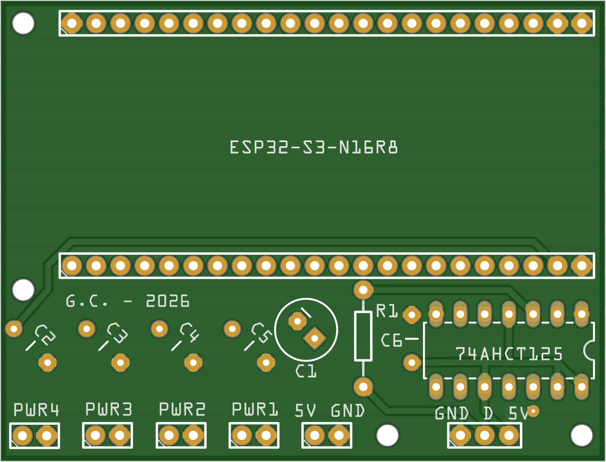
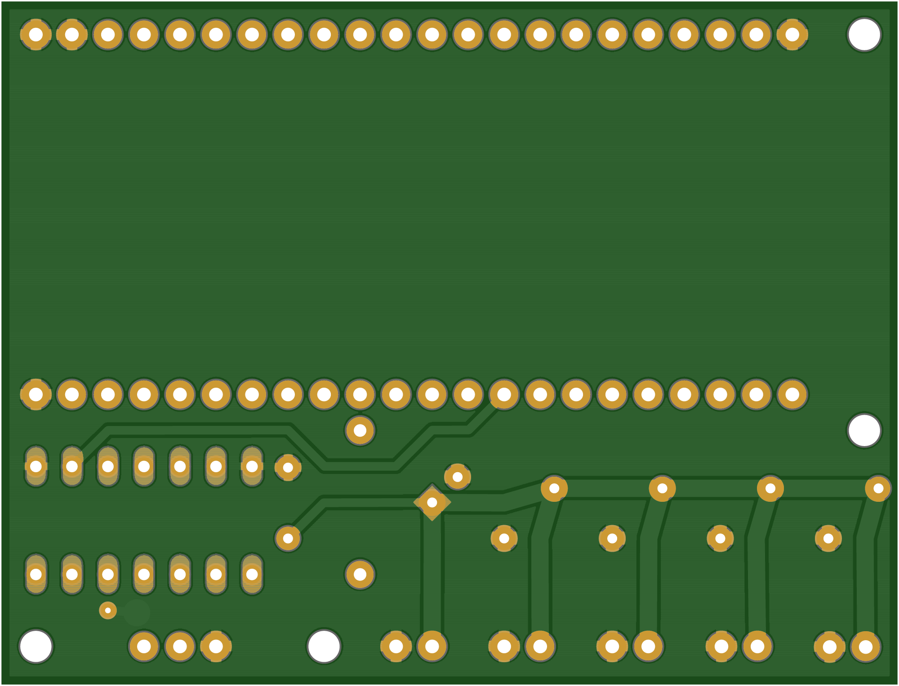

The reference build is four flexible WS2812B 32x8 panels in a 2x2 grid (64x16 pixels, 1024 LEDs), an ESP32-S3 dev board, one level shifter, and a USB-C socket for power. The drawing above is to the cut sizes in `3D/8x32/`: a 670 by 190 mm sheet, a 10 mm LED pitch, and the twelve 20 by 30 mm cutouts the panel wiring passes through. The firmware itself supports any grid the [arrangement editor](../../admin-guide/arrangement-editor/) can describe: up to 8 rows by 16 columns, 32 panels, 8192 pixels.

The PCB expects **5 V LED panels**: the power rail, the level shifter reference and the connectors are all laid out for 5 V WS2812B-class matrices. 12 V panel variants (WS2815 and similar) need a different power arrangement and are not supported by this board.

## Parts

| Part | Choice | Notes |
|------|--------|-------|
| MCU board | ESP32-S3-DevKitC-1 (ESP32-S3-WROOM-1 N16R8) | 16 MB flash, 8 MB PSRAM, native USB for flashing |
| LED panels | WS2812B matrix, 8x8 / 16x16 / 8x32 | The three sizes commonly sold; flexible or rigid both work |
| Level shifter | SN74HCT125N | 3.3 V logic to the 5 V data level the panels want |
| Series resistor | 330 ohm | Damps reflections on the data run between board and first panel |
| Power input | USB-C breakout, CC1 and CC2 each pulled to GND through 5.1 kohm | Advertises a plain 5 V / 3 A sink, no PD chip needed |
| Connectors | JST-SM on the panels, 2.54 mm headers on the PCB | The board's pads are plain 0.1 in through-hole headers; 2- and 3-pin JST-XH sockets fit them, and JST-SM to JST-XH pigtails bridge to the panels |
| Light sensor | Optional: an LDR plus a 10 kOhm to 100 kOhm resistor, or an analog lux module | Divider output to an ADC1 pin (GPIO1 to GPIO10) lets the room set the brightness, see the [light sensor guide](../../admin-guide/light-sensor/) |

The `PCB/` directory holds the Fritzing source and Gerbers for the controller board (revision v3), described in [the controller board](#the-controller-board) below. `3D/` holds the enclosure parts:

| File | Format | Part |
|------|--------|------|
| `3D/8x32/Front and back panels.dxf` | DXF, laser-cut | The front and back sheets of the panel sandwich, cut twice from smoked grey plexiglass |
| `3D/8x32/Display modules support panel.dxf` | DXF, cut | The aluminium middle panel the LED panels are glued to, with square holes where each panel's wires exit |
| `3D/8x32/Spacers.stl` | STL, printed | Spacers in two lengths: thin between front panel and support panel, long between support panel and back panel |
| `3D/Box for PCB_v2.stl` | STL, printed | Case for the controller board, with openings for the JST connectors |
| `3D/USB type c connector flange.stl` | STL, printed | Mount for the panel-mount USB-C power socket |

Only these exports are tracked; the SketchUp sources the parts were modelled in are not. The [assembly guide](../assembly/) puts the stack together step by step.

## The controller board



The board is a carrier, not a complete design. It sockets an off-the-shelf ESP32-S3 dev board and adds the four things the dev board cannot do on its own: shift the data line to 5 V, damp it with a series resistor, decouple the supply, and split incoming 5 V across enough connectors that panel current never travels through the signal daisy-chain.

Everything on it is through-hole, so it is hand-solderable with no reflow and no fine-pitch work.

| | |
|---|---|
| Size | About 63.6 by 48.6 mm |
| Layers | 2, both with routing and a ground pour, stitched by a single via |
| Holes | 90 drilled: 86 plated, plus 4 unplated 2.2 mm mounting holes, one near each corner |
| Mounting | The 2.2 mm holes clear an M2 screw |
| Components | 1 IC, 1 resistor, 6 capacitors, 6 connectors, all through-hole |
| Ground | Not routed as traces: it is carried by copper pours on both layers |

The figures above come from the files themselves rather than from a datasheet: the outline from `RGB display_v3_contour.gm1`, the hole count and diameters from `RGB display_v3_drill.txt`, the layer count and the parts from the Fritzing sketch. The contour is stroked on its centreline, which leaves the finished size ambiguous by the 0.2 mm width of the outline aperture depending on how your fab interprets it.

### Connectors

Six connectors along the bottom edge, all through-hole on 0.1 in (2.54 mm) pitch:

| Silkscreen | Positions | What it is for |
|---|---|---|
| `5V` `GND` | 2 | Power in. This is where the USB-C breakout or the bench supply lands |
| `PWR1` | 2 | 5 V and GND out to a panel |
| `PWR2` | 2 | 5 V and GND out to a panel |
| `PWR3` | 2 | 5 V and GND out to a panel |
| `PWR4` | 2 | 5 V and GND out to a panel |
| `GND` `D` `5V` | 3 | Data out to the first panel in the chain, through the level shifter and the 330 ohm resistor |

The four `PWR` connectors are the point of the board. The [data chain](#data-chain) section below says to feed each panel's power directly from the supply rather than through the daisy-chained signal wires; these are what you feed it from. One per panel in the reference 2x2 build, wired in parallel from the same input, with the wider traces on the bottom layer carrying the current between them.

Only one connector carries the signal. `GND` `D` `5V` goes to the first panel's DIN; every panel after that is chained panel-to-panel as normal.

### Bottom



The bottom layer carries the power distribution on visibly wider traces and the rest of the ground pour. There is no bottom silkscreen, so the board is blank on that side apart from the copper.

### What is not on the board

Three things the parts table lists that this PCB has no footprint for, and that have to be wired to it:

- **The USB-C power input.** There is no USB-C footprint and no 5.1 kohm CC resistors here. That is a separate breakout module, wired into the `5V` `GND` pads. R1 (330 ohm) is the only resistor on the board
- **The light sensor.** No connector and no divider footprint. Wire it to an ADC1 pin on the ESP32 header directly
- **The ESP32 itself.** It is socketed in two 22-way female headers with their rows 25.4 mm apart, not soldered down. Check that spacing against the dev board you intend to use before ordering: some ESP32-S3 boards are 0.9 in rather than 1.0 in wide

### Two things the files do not tell you

Worth knowing before you order a set:

- **The capacitor values are not specified anywhere in the design.** C1 is a polarised radial on 2.54 mm lead pitch; C2 to C6 are non-polarised on 5 mm pitch. The Fritzing sketch leaves all six values blank, so the footprints tell you what fits but not what to fit. None are marked do-not-populate
- **The board is silkscreened `74AHCT125`**, which is the name of the Fritzing part the footprint came from. The part to fit is the **SN74HCT125N** in the table above. Both are quad three-state buffers in the same DIP-14 pinout, so the footprint is right either way

One cosmetic defect, if you respin it: in the exported top silkscreen the `ESP32-S3-N16R8` label and the `C2` to `C5` designators are mirrored, while the rest of the text is not. They will print backwards on a real board.

### Rendering the board

The images above are generated from the Gerbers, so they show what a fab would actually make rather than what the editor draws:

```sh
npx --yes @tracespace/cli@4.2.8 --out . "PCB/Gerber files/"*.g* "PCB/Gerber files/RGB display_v3_drill.txt"
```

That writes `RGB display_v3_.top.svg` and `.bottom.svg`. Convert those to PNG for the docs: the SVG is a couple of megabytes because Fritzing exports the ground pour as thousands of hairline strokes rather than a filled region.

## Why the level shifter

WS2812B specifies logic-high as 0.7 x VDD. At a 5 V supply that is 3.5 V, and the ESP32's 3.3 V output sits below it. Some chains tolerate that margin, many glitch. One SN74HCT125 channel fixes it:

| SN74HCT125 pin | Connects to |
|----------------|-------------|
| 1 (1OE) | GND (enables channel 1 permanently) |
| 2 (1A) | ESP32 GPIO 16 (`LED_DATA_GPIO` in the firmware) |
| 3 (1Y) | 330 ohm resistor, then the first panel's DIN |
| 7 (GND) | Common ground |
| 14 (VCC) | 5 V from VBUS |
| Unused xOE pins | Tie to VCC to disable |

## Data chain

Each panel has a 3-pin signal connector (5 V, data, GND) with DIN on one side and DOUT on the other. Chain DOUT to the next panel's DIN in whatever order keeps the cabling short; the arrangement editor adapts the mapping to the order you ended up with, including panels mounted upside down. Feed each panel's power directly from the supply rather than through the daisy-chained signal wires, which are too thin to carry several panels' current.

## Power budget

Numbers measured on the prototype rig on 2026-05-20: one 32x8 panel, fully lit in the stored amber (80, 32, 0) at brightness 255, drew 7.7 W at the USB-C input. Linear extrapolation puts the full 2x2 grid around 31 W at that intensity, which is far past the 15 W a plain USB-C source provides. At the intended dim operating point (brightness 32, displayed colour around (10, 4, 0)) the full grid needs roughly 4 W and a plain USB-C supply is fine.

Two consequences:

- Keep the brightness cap set (Hardware tab). It clamps the slider and every API request, so no automation can push the panel past what the supply survives
- If you want full-brightness white on a large grid, plan a 5 V / 5 A supply negotiated by a PD trigger (CH224K or IP2721) instead of the 5.1 kohm resistor trick

An [ambient light sensor](../../admin-guide/light-sensor/) helps here as well: with the upper end of its brightness range set inside the budget, the display only draws its peak in a room bright enough to need it.

The refresh rate also scales with size: WS2812B needs about 30 microseconds per LED, so 1024 pixels refresh at about 33 Hz and the 8192-pixel maximum at about 4 Hz. Fine for a static readout, visible on fast scrolling.
