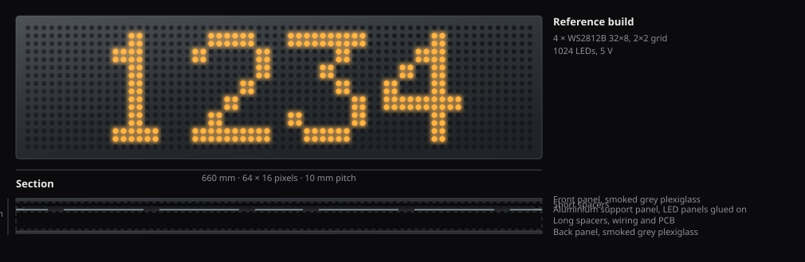

led-display is firmware for a wall display made of daisy-chained WS2812B matrix panels, driven by an ESP32-S3. The display shows one number or short message at a time, pushed to it over HTTP by whatever you like: a home automation flow, a cron job, a plain `curl`. Typical uses are a revenue figure, a subscriber counter, or a temperature that should always be visible somewhere.

The panel configuration is a runtime model rather than something compiled in: you describe the physical build in a graphical editor and the firmware rebuilds its pixel mapping on the fly.

The drawing is to the cut geometry in `3D/8x32/`: a 670 by 190 mm sheet with twelve perimeter fixings, a 10 mm LED pitch, and the wire cutouts through the support panel. The lit pixels are drawn with the firmware's own font, so they are the ones the device would light.

## What is in the repository

| Directory | Content |
|-----------|---------|
| `Firmware/` | ESP-IDF v6 application: C sources, the embedded web UI, the vendored WireGuard component, host-side unit tests, and a WSL build helper |
| `PCB/` | Fritzing source and exported Gerbers for the controller board (current revision v4) |
| `3D/` | Enclosure parts as DXF outlines to cut and STL to print: under `8x32/` the front and back panels, the LED panel support panel and the spacers of a 32x8 build, plus the controller case and the USB-C connector flange. The SketchUp sources are not tracked, only the exports |
| `docs/` | This documentation site (Astro Starlight) |

## What the firmware does

The display side is deliberately simple. It renders text in one colour at a time, static or scrolling, in one of three pixel fonts (5x7, a tiny 3x5, a tall 7x12 with real lowercase) at integer sizes, proportionally spaced with fixed-width digits. The web UI covers the routine controls: text, a colour picker plus up to 12 saved colours kept as one-tap chips, brightness, text size and spacing, scroll mode and speed. A weekly schedule turns the display off, or holds it at a dim level, at set times per weekday, using NTP-synced time. An optional BH1750 lux meter on the board's I2C connector can set the brightness from the room instead.

The arrangement editor (Hardware tab, advanced mode) describes the physical build instead of hardcoding it. You pick one panel type, with 8x8, 16x16, and 8x32 presets or custom sizes up to 64x64 pixels, set the wiring (first-LED corner, row or column walk, serpentine), and place panels on a grid of up to 8 rows by 16 columns, capped at 32 panels and 8192 pixels. Drag a panel onto another cell to swap them, tap a panel to rotate it, and use identify mode to light every physical panel in a distinct colour so you can match the drawing to the wall. Applying a layout validates it, rebuilds the pixel mapping live, and persists it.

For pushing data there is a dedicated value endpoint: `POST /api/value` accepts a raw number or string, and the firmware formats it through a configurable template (prefix, suffix, decimals, thousands separator) before showing it. An optional MQTT client takes the same values over a broker instead, and can announce itself to Home Assistant. A staleness guard reacts when no new value has arrived for a configured number of hours: dim the display, blink a corner pixel, or replace the readout with a warning text.

On the network side the device keeps up to five WiFi networks, joins the strongest one in range at boot, retries a lost link with a growing backoff, and falls back to its own setup network when nothing answers. One device name sets the hostname, that setup network's SSID, and the name the device reports in webhooks.

Operationally, firmware updates go over the air after the initial USB flash: upload a `.bin` from the browser or have the device pull one from a URL, with two OTA slots and automatic rollback if a new image fails to come up. The whole configuration exports as one JSON file and imports back, WiFi credentials deliberately excluded. An optional API key gates every mutating request behind an `X-Api-Key` header. Outbound webhooks POST device events (boot, IP change, OTA result, schedule on and off, stale value) to one configurable URL, consumable by anything that accepts a webhook. Finally, an optional WireGuard client (compiled in by default, inactive until configured) covers remote access without port-forwarding the device.

## Where to go next

- [Hardware](../hardware/) for the parts list, wiring, and power budget
- [Assembly](../assembly/) to build the reference display from the cut and printed parts
- [First flash](../first-flash/) to build the firmware and flash it over USB
- [WiFi setup](../wifi-setup/) to put the display on your network
