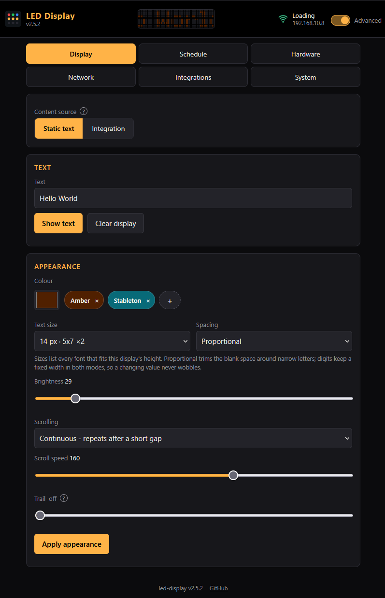

The Display tab, at `/display` in the browser, is the first tab of the web UI. Every tab has its own address, so a reload, a bookmark or the back button all land where you were. It controls what the display shows: the content source, the text, its colour, the brightness, whether it scrolls, and which font it uses at which size. Everything you apply here is saved to flash and comes back after a power cycle.

The header of the web UI carries a live preview of the panel: the same text in the same colour, scrolling if the panel scrolls. It is a simulation drawn from the device's reported state, not a screenshot, so it also works while the panel itself is out of sight.

## Content source

The switch at the top decides where the panel content comes from:

- **Static text** shows whatever you type in the Text card below
- **Integration** shows the last value pushed by your integration (the [value endpoint](../value-updates/) or [MQTT](../../admin-guide/mqtt/)), formatted per the Integrations tab. Until the first value arrives - right after a reboot, for instance - the panel shows the placeholder text configured with the [value settings](../value-updates/#formatting), or stays blank if none is set

Switching is immediate and persisted. Values pushed while the source is static are still accepted and remembered; switching to integration shows the latest one.

## Text

Type the text and press Show text. The input accepts up to 120 characters (the API accepts up to 127, see the [API reference](../../api-reference/)). Every font covers printable ASCII (characters 32 to 126); anything outside that range renders as `?`. The card is only shown while the content source is static.

Static text is centered horizontally. If the text is wider than the display, pick a scroll mode, otherwise the right-hand part is cut off.

Clear display blanks the display and erases the stored text; all other settings stay.

## Appearance

Colour, text size, spacing, brightness, and scrolling live in their own card and apply to both content sources. Press Apply appearance to send them in one go; the text itself is left alone.

## Colour

The colour picker sets the text colour. Applying a colour does not interrupt the text: picking a saved colour chip changes the colour of what is already showing without re-sending the text.

### Saved colour chips

Chips are colour presets stored on the device itself, so every browser and phone that opens the UI sees the same list. The list holds at most 12 entries.

- Add: press the `+` chip to save the current picker colour. You are asked for a name (up to 16 characters); leaving it empty uses the hex code
- Apply: tap a chip. The displayed text switches to that colour immediately
- Remove: press the small `x` on the chip, or long-press the chip

## Brightness

The slider runs from 0 to 255 and takes effect when you press Apply. 0 is dark, 255 is full power.

The slider's maximum can be lower than 255: the brightness cap, set on the Hardware tab in advanced mode, limits how bright the display may go to protect the power supply. The slider never goes above the cap, and API requests asking for more are silently clamped to it rather than rejected. See the [admin guide](../../admin-guide/) for the cap itself.

The display can also dim or go dark on its own: the [schedule](../schedule/) turns it off or holds it at a dimmed level outside the configured hours, the [staleness guard](../value-updates/#the-staleness-guard) can halve the brightness when a value stops updating, and the [light sensor](../../admin-guide/light-sensor/) can set the brightness from the room.

Once the light sensor is switched on and has produced a level, the slider shows that level and stops being an input; a note under it says so. It stays an input until then, and also while the device runs its own [setup network](../../getting-started/wifi-setup/), where the sensor is bypassed. Your saved level is kept untouched and comes back the moment you switch the sensor off.

## Scrolling

Scrolling has three modes:

| Mode | What the text does |
|------|--------------------|
| Off | stays put, centered horizontally |
| Restart | enters from the right edge, moves left, and re-enters from the right once it has fully left the display |
| Continuous | repeats as a marquee: the next copy follows the tail after a gap of two character cells, so the display is never empty |

The speed slider runs from 0 to 255. It maps to the time each one-pixel step takes: about 200 ms per step at 0 and about 15 ms per step at 255. The slider is disabled while scrolling is off.

The IP address or setup banner the device shows at boot always scrolls continuously, whatever this setting is, so an address you are trying to read comes back around.

## Font, size, and spacing

Three pixel fonts are built into the firmware:

| Font | Cell | Notes |
|------|------|-------|
| 5x7 | 5 x 7 px | the default, a plain readout font |
| 3x5 | 3 x 5 px | tiny, for short panels; lowercase letters use the uppercase shapes, because no readable lowercase exists at this height |
| 7x12 | 7 x 12 px | tall, with real lowercase including descenders |

Text size combines a font with an integer magnification: a glyph at factor N is N times as tall and wide. The Text size list offers the combinations that fit the active display height, labelled by their pixel height, so on a 16-pixel-tall display you get 3x5 up to three times over, 5x7 up to twice, and 7x12 once. Glyphs are centered vertically.

One extra entry appears when the stored size no longer fits, which happens after shrinking the layout: the old size stays in the list marked "taller than this display", so it is still what the box shows and Apply keeps working on everything else. Pick a size that fits to stop the fallback rendering.

The clamp is enforced on the device too: the API accepts factors 1 to 8, clamps them to what fits, and falls back to the tallest font that fits if the stored font is too tall for the current layout. Your choice is remembered and comes back when a tall enough layout does. The default after a reset is the largest whole multiple of the font height that fits, up to three.

Spacing decides how the glyphs advance:

- Proportional (the default) trims the blank columns on both sides of narrow letters, so words look evenly spaced
- Monospace gives every character the full cell width, which lines text up in columns

Digits are fixed-width in both modes. A ticking value therefore keeps a stable width instead of jittering as the digits change.

## Related pages

- [Schedule](../schedule/): turn the display off or dim it at night
- [Value updates](../value-updates/): let another system set the text
- [Screens](../screens/): what the panel shows at power-on and when the WiFi link drops
- [Light sensor](../../admin-guide/light-sensor/): set the brightness from the room
